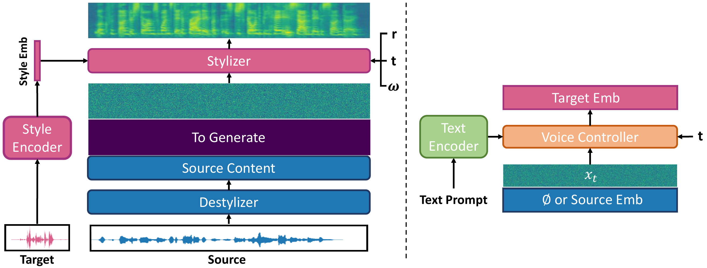

<h1 align="center">
  StyleStream 2.0
</h1>

<p align="center">
  <a href="https://arxiv.org/abs/2610.28940"></a>
  <a href="https://berkeley-speech-group.github.io/StyleStream2.0/"></a>
  
  <a href="./LICENSE"></a>
</p>

<p align="center">
  <strong>StyleStream 2.0: Fast and Controllable Streaming Voice Style Conversion</strong>
</p>

<p align="center">
  Yisi Liu · Nicholas Lee · Gopala K. Anumanchipalli<br />
  University of California, Berkeley<br />
  <strong>NeurIPS 2026</strong>
</p>

<p align="center">
  The official project page and demos for StyleStream 2.0.<br />
  <strong>Inference code and pretrained checkpoints are coming soon.</strong>
</p>

<p align="center">
  
</p>

## News

- 🎉 StyleStream 2.0 has been accepted to **NeurIPS 2026**!

## Release Status

This repository currently hosts the demo page and its audio/video samples.

- **arXiv paper:** [2610.28940](https://arxiv.org/abs/2610.28940).
- **Inference code:** coming soon.
- **Pretrained checkpoints / Hugging Face model:** being prepared.

For the original StyleStream paper, demos, and inference code, see [StyleStream](https://github.com/Berkeley-Speech-Group/StyleStream).

## License

This project uses the same **research, educational, and not-for-profit software license** as StyleStream. See [LICENSE](./LICENSE) for the full terms.

Commercial use requires prior written permission from The Regents of the University of California.

## Citation

If you find StyleStream 2.0 useful, please consider citing our paper:

```bibtex
@article{liu2026stylestream2,
  title={StyleStream 2.0: Fast and Controllable Streaming Voice Style Conversion},
  author={Yisi Liu and Nicholas Lee and Gopala K. Anumanchipalli},
  journal={arXiv preprint arXiv:2610.28940},
  year={2026}
}
```
